  

  
  

Árvore is a Brazilian edtech. Schools use our platform so kids read more, read better and actually enjoy it. Building that, we keep making tools for ourselves, mostly around AI agents and owning our own stack, and we open source the ones that might help you too.

### Agents

  
  

  
  

  
  

### Own your stack

  
  

  
  

  

### Contributing

Every repository takes issues and pull requests. Once one of yours lands, grab your contributor badge and share card at [oss.arvore.com.br](https://oss.arvore.com.br).

  

